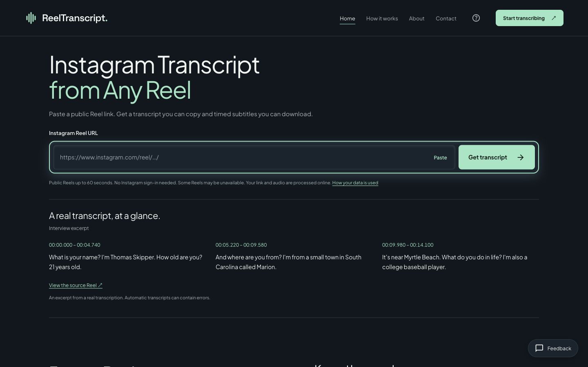
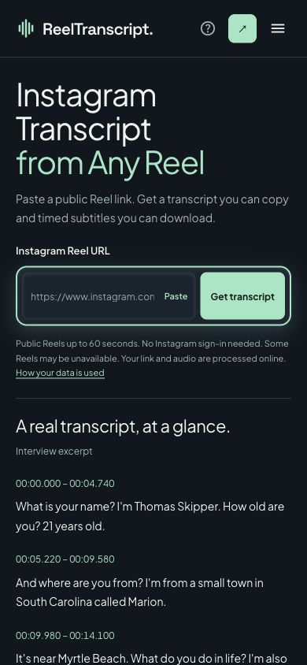

# 首页改版 V2：只补差异

生产地址：https://reelstranscript.com/

部署 `dpl_J55pzGNZj9JrKuxmuBJn5yvLLHGW`：READY / production。

## 动工前对照与唯一基线

先从线上抓取了 [baseline.html](baseline.html)，没有拿本地已修改文件作为基线。实际线上已是上一轮输入区改版，原始输出：

```text
Online baseline bytes: 2897
/assets/index-jhGtbine.js
/assets/index-B5Kj3tMx.css
```

| 新版清单 | 动工前状态 | 本轮处理 |
|---|---|---|
| 改动 1：聚焦输入区 | 已完成：60px、同排、Paste、聚焦态、留白、合并限制说明、真实示例移至下方 | 全部复用；ReelTranscriber.tsx 与相关 CSS 不重写 |
| 改动 2a：删除旧音频卡 | 已完成 | 不重复改动 |
| 改动 2b：删除特性横条 | 未做 | 整块删除 |
| 改动 2c：删除 Transcribe a Reel | 已完成 | 保持删除 |
| 改动 3：合并 How it works | 未做 | 合为一个区块；H2 保留 From a Reel. To readable text.；Keep the words. Keep the timing. 降为 H3；三步原文保留 |
| 改动 4：FAQ 时长、收尾 CTA | 未做 FAQ；旧任务要求下收尾区被删除，与新版要求不符 | 新增指定问答；恢复原收尾区并使用 Get transcript ↗ |
| 改动 5：Feedback | 未做防遮挡处理 | 仅手机首页隐藏悬浮入口；导航与页脚联系入口保留 |

没有回滚上一轮正确实现。可选静态 SRT 卡跳过，避免增加与首屏输入组件竞争的内容，现有真实示例完整保留。

## 本轮改动文件

- `views/LandingView.tsx`：删除特性横条；合并两块说明；新增 FAQ 时长问答；恢复收尾区并更名按钮。
- `website.css`：只补首页合并流程区分隔与小标题排版；在现有 760px 手机断点内隐藏首页 Feedback。未改字体、配色、主题切换或其他页面样式。
- `tests/website.test.cjs`：补上特性横条删除、H2/H3 数量、四条 FAQ 与收尾文案断言。
- 本目录：线上基线、输出、截图与报告。

说明段取舍：删去 `Bring the words from a public Instagram Reel onto the page. Review the transcript, then save the text or timed subtitles.`，其公开链接输入、文字结果与保存方式均被三步流程覆盖。保留原有 `An interview, an explanation, a story. Start with a public Instagram Reel.`，提供场景例子；保留免登录与刷新前保存提示。保留 `Read the quick guide →`，删除同一流程另一条重复的 How it works 链接。

## 改后结构清单（与生产默认渲染一致）

下面按顶部导航到页脚排序。普通链接与按钮外观链接分别说明，FAQ 的 summary 是折叠控件，不冒充新增 H3。

| 顺序 | 一级区块／可见名称 | H2 数 | H3 数 | 按钮／操作 |
|---:|---|---:|---:|---|
| 1 | ReelTranscript 顶部导航 | 0 | 0 | Start transcribing ↗（按钮外观链接）；手机另有 Open navigation 菜单按钮。Home / How it works / About / Contact 为普通导航链接 |
| 2 | Instagram Transcript from Any Reel | 1 | 0 | Paste、Get transcript。区块内含完整的 A real transcript, at a glance. 示例（该示例贡献 1 个 H2） |
| 3 | From a Reel. To readable text. | 1 | 4 | 无按钮；Read the quick guide → 为纯文字链接。H3 为 Keep the words. Keep the timing. 与三步各自标题 |
| 4 | Your result stays on this page. | 1 | 0 | 无按钮；About your data → 为纯文字链接 |
| 5 | Before you paste a link. | 1 | 0 | 四个 FAQ 折叠控件：Which links are supported? / Do I need to sign up? / Does it work on my computer and phone? / How long can the Reel be? |
| 6 | Your next Reel, ready to read. | 1 | 0 | Get transcript ↗（按钮外观链接） |
| 7 | ReelTranscript 页脚 — Public Reels. Readable transcripts. Timed subtitles. | 0 | 0 | 无按钮；About / Contact / Data & privacy / How it works / Settings 为普通链接 |

桌面另有 Feedback 悬浮联系链接，不属于一级正文区块；手机首页隐藏。成功转录后工具区会按原逻辑多出 Your transcript 结果区（H2 +1，Copy text / Download SRT）；本表和数量比较均按未提交时默认状态统计。

标题计数的浏览器原始数据见 [baseline-dom.json](baseline-dom.json) 与 [production-dom.json](production-dom.json)：

```text
Rendered H1: 1 -> 1
Rendered H2: 5 -> 5
Rendered H3: 3 -> 4
Static shell H1: 1 -> 1
Static shell H2: 1 -> 1
```

H2 总数保持 5 的原因：Keep the words 降为 H3（-1），本轮按新要求恢复收尾区 H2（+1）。

## 逐项验收与原始输出

### 1. 静态壳逐字保护

[baseline.html](baseline.html) 与 [changed.html](changed.html) 均为 2897 字节。title、description、canonical、og:title、og:description、og:url、robots、H1、副标题、完整示例与 noscript 共 11 组逐字一致。所有字段原文见 [protected-fields.txt](protected-fields.txt)。源 index.html 整文件哈希未变。

受保护字段 diff 无差异；归一化构建产物文件名后，完整 HTML 的 [static.diff](static.diff) 为空。未声称原始 HTTP 响应全文零差异，完整 [full-static.diff](full-static.diff) 仅有两行产物引用变化：

```diff
- /assets/index-jhGtbine.js
- /assets/index-B5Kj3tMx.css
+ /assets/index-B1Ol6At4.js
+ /assets/index-mtaBpavg.css
```

没有手改任何 head 内容。两种原有副标题（静态壳与 React 渲染）各自逐字保留，未删字或重写以凑手机一行。

### 2–3. 原始 HTTP 检查

```text
Baseline bytes: 2897
Changed bytes: 2897
Protected fields: 11/11 identical
Full static HTML diff after normalizing asset filenames: (empty)
static HTML 'every word on the first listen' matches: 0
static HTML 'Synthetic voice' matches: 0
static HTML 'An audio preview' matches: 0
static HTML 'Hear it for yourself' matches: 0
static HTML 'YOUR REEL' matches: 0
static HTML 'Transcribe a Reel' matches: 0
Static h1: 1
Static h2: 1 -> 1
Assets: ['/assets/index-B1Ol6At4.js', '/assets/index-mtaBpavg.css']
Frozen source files: identical; sitemap / robots / manifest: byte-identical
[
  {
    "path": "/about",
    "status": 200,
    "unchanged_except_asset_names": true
  },
  {
    "path": "/help",
    "status": 200,
    "unchanged_except_asset_names": true
  },
  {
    "path": "/privacy",
    "status": 200,
    "unchanged_except_asset_names": true
  },
  {
    "path": "/contact",
    "status": 200,
    "unchanged_except_asset_names": true
  },
  {
    "path": "/settings",
    "status": 200,
    "unchanged_except_asset_names": true
  },
  {
    "path": "/tiktok-transcript",
    "status": 200,
    "unchanged_except_asset_names": true
  }
]

```

渲染后的全页文字同六个字符串也各为 0，见 production-dom.json 的 removed 数组；没有只检查未执行 JS 的静态壳。这里验证的是页面输出，未删除不在首页渲染的历史数据文件或功能代码。

### 4–5. 桌面、手机截图

使用内置浏览器，未使用翻译插件或翻译功能；截图为英文原文，与采集 DOM 一致。截屏前未滚动；桌面原图 1440×900，手机原图 390×844。完整输入框、Paste 与主按钮位于第一屏。

桌面 input 与 submit 均高 60px，top=355.265625，bottom=415.265625；无横向溢出。

手机原始输出：

```json
{
  "feedbackDisplay": "none",
  "input": {
    "bottom": 405.6796875,
    "height": 60,
    "left": 28,
    "right": 248.4921875,
    "top": 345.6796875,
    "width": 220.4921875,
    "x": 28,
    "y": 345.6796875
  },
  "overflow": false,
  "scrollY": 0,
  "submit": {
    "bottom": 405.6796875,
    "height": 60,
    "left": 254.4921875,
    "right": 362,
    "top": 345.6796875,
    "width": 107.5078125,
    "x": 254.4921875,
    "y": 345.6796875
  },
  "viewport": [
    390,
    844
  ]
}
```

Feedback 为 display:none，所有滚动位置都不会遮住手机首页可点元素。仅首页受此样式影响，其他六页未改。





[生产整页截图](production-full.jpg) · [桌面基线](baseline-desktop.jpg) · [手机基线](baseline-mobile.jpg) · [视觉核对](visual-verdict.json)

视觉焦点是截图判断，未声称做过眼动实验；可量化的输入尺寸、位置、聚焦状态、反馈按钮隐藏和无溢出均已检查。

### 6. 手机视口真实端到端

粘贴公开 Reel 后，输入框 value 与 focused 原始输出见 paste-check.json：

```json
{"focused":"reel-url","value":"https://www.instagram.com/reel/DeejOF4AfBe/"}
```

显示等待态后成功得到 7 条 cue；点击 Copy text，显示 Transcript copied，实际剪贴板文字与页面逐词一致（仅归一空白比较）。随后点击 Download SRT，并从浏览器实际下载位置打开文件读取：

```json
{
  "url": "https://www.instagram.com/reel/DeejOF4AfBe/",
  "cueCount": 7,
  "copyMatchesVisibleText": true,
  "downloadPath": "/Users/aurrordediannao/Downloads/reel-transcript (3).srt",
  "srt_timestamp_lines": 7,
  "first_timestamp": "00:00:00,000 --> 00:00:03,280"
}
```

[下载文件副本](downloaded.srt) 首条：

```srt
1
00:00:00,000 --> 00:00:03,280
Guys, my son died.
```

7 条 cue 均有标准 `HH:MM:SS,mmm --> HH:MM:SS,mmm` 时间戳。浏览器对重名文件自动加 `(3)`，产品原下载名 `reel-transcript.srt` 未变。

[等待态截图](production-wait.jpg) · [实际结果/复制成功截图](production-result.jpg) · [复制原文](copied.txt)

## 测试与冻结范围

```text
Typecheck: exit 0
Tests: 111; pass: 111; fail: 0
Build: exit 0
```

证据：[types.log](types.log)、[tests.log](tests.log)、[build.log](build.log)。

Frozen source hashes 全部一致，包括 App.tsx、ReelTranscriber.tsx、导航、元信息、渲染器、后端、requirements、部署配置、public 文件与其他 views。`/about /help /contact /privacy /settings /tiktok-transcript` 源码未改，生产抓取原始正文除公共产物文件名外与本轮线上基线一致；sitemap / robots / manifest 的生产响应逐字节一致。

不新建 SRT 展示卡，不新增依赖，不做额外重构。本轮未提交混杂工作区的其他改动。
