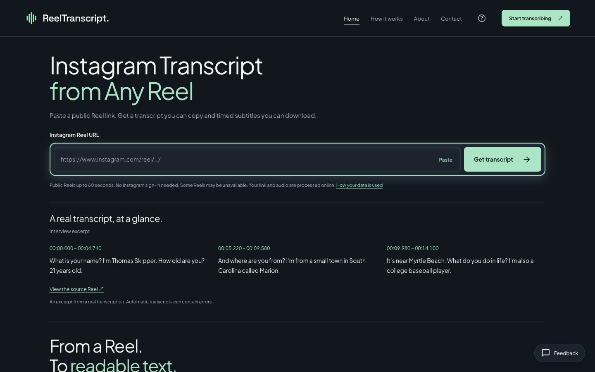
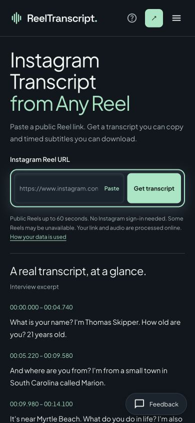

# 首页输入优先改版验收

生产地址：https://reelstranscript.com/

部署：`dpl_DYWBcXgQ9Jvdn63DHigXmh8ATWKT`，READY，production。

## 本轮改动

| 文件 | 改前 | 改后 |
|---|---|---|
| components/ReelTranscriber.tsx | 输入与提交按钮分行、限制说明两段 | 60px 等高同行组合；Paste 读取剪贴板并聚焦；说明合成一段；剪贴板不可用时提示手动粘贴 |
| views/LandingView.tsx | 合成音频卡、第二屏按钮、末尾重复 CTA | 删除上述组件与对应播放状态/事件处理；保留第二屏左栏原文字与 How it works 文字链接 |
| website.css | 双列首屏、独立高对比示例卡 | 全宽输入区、强调边框与内阴影、清晰聚焦态；示例置于下方，桌面三列/手机逐条；只复用原主题变量与字体 |
| tests/website.test.cjs | 断言首页含旧样例音频及重复首页链接 | 改为断言旧音频卡/重复 CTA 不存在、Paste 存在、唯一 H1 与第二屏说明保留 |

无替代区块、无新依赖、无动画库、无新字体或配色。沿用现有 760px 手机断点，其他响应式断点未改。输入处理/转录请求/结果复制/SRT 格式与命名均保持原逻辑；新增的唯一交互是要求的剪贴板粘贴。

## 1. 静态 HTML 保护项与 diff

实际 curl 下载前后 HTML：[before.html](before.html)、[after.html](after.html)。两份均为 **2897 字节**。

受保护字段原文见 [protected-fields.txt](protected-fields.txt)，9 组逐字一致：title、description、canonical、og:title、og:description、H1、副标题、三条带时间戳真实示例、noscript。

源码 index.html 整文件哈希未变。完整响应唯一差异是构建产物文件名：

```diff
- /assets/index-CNPceG4-.js
- /assets/index-ssdagump.css
+ /assets/index-jhGtbine.js
+ /assets/index-B5Kj3tMx.css
```

将上述文件名归一后，全 HTML unified diff 原始输出为空，见 [static.diff](static.diff)。未将文件名变化误报成原始响应逐字相同。

副标题在静态壳和 React 页面原本就是两种措辞，本轮两者各自原样保留，没有为了缩为一行而删字。桌面 React 副标题单行；手机按原文字自然换行。

## 2. 旧卡片文案零命中

生产静态 HTML 原始检查输出：

```text
'every word on the first listen' matches: 0
'Synthetic voice' matches: 0
'An audio preview' matches: 0
'Hear it for yourself' matches: 0
'Transcribe a Reel' matches: 0
h1 count: 1
```

渲染 DOM 的同五项也各 0；正文 `.landing a.button` 数量 0（导航 Start transcribing 保留；输入表单 Get transcript 为正文唯一主 CTA）。[浏览器原始输出](browser-checks.json)

## 3–4. 桌面与手机首屏

桌面设置视口 **1440×900**，使用明确 1440×900 clip 保存截图；手机 **390×844**。二者无须滚动即可完整看到并使用输入框、Paste 与 Get transcript，无横向溢出。

桌面输入框与按钮：height=60；top=355.265625；bottom=415.265625。手机：height=60；top=345.6796875；bottom=405.6796875。

桌面限制说明为一行，手机为同一段自然折行，所有限制和隐私链接均保留。未强行把手机说明缩小到不可读的一行。

[桌面改前](before-desktop.jpg) · [手机改前](before-mobile.jpg) · [桌面改后](production-desktop-exact.jpg) · [手机改后](production-mobile.jpg) · [浅色手机检查](after-mobile-light.jpg)





输入框是否为第一眼落点属于视觉判断，未做眼动实验。截图检查给出的判断是通过；机器可验证项是强调边框、全宽组合、60px 等高、首屏位置、示例降权和重复 CTA 删除。[visual-verdict.json](visual-verdict.json)

## 5–6. CTA 与 H1

全页渲染文字 `Transcribe a Reel`: 0；旧音频四种文案: 0；渲染 H1: 1。

静态 H1 原文：`Instagram Transcript from Any Reel`。渲染 H1 在原有换行展开后相同。前后 H1 均未改字。

## 7. 字节数与产物

```text
Static bytes before / after: 2897 2897
Assets: index-jhGtbine.js index-B5Kj3tMx.css
```

[构建原始输出](build.log)：JS 293.94 kB，CSS 52.68 kB。没有进行字体/性能重构。

## 8. 正式站浏览器真实回归

使用公开链接 `https://www.instagram.com/reel/DeejOF4AfBe/`：

1. 将该链接放入浏览器剪贴板，点击 Paste；输入框显示该链接并获得焦点。
2. 点击 Get transcript，显示 Transcribing、可见进度与 elapsed timer；随后显示 Your transcript 和 7 条 cue。
3. 点击 Copy text：显示 `Transcript copied.`；读取浏览器剪贴板，非空且按空白归一后与页面所有 cue 逐字一致。
4. 点击 Download SRT，浏览器保存到 `/Users/aurrordediannao/Downloads/reel-transcript (2).srt`（系统同名文件后缀）；产品下载名仍是 `reel-transcript.srt`。
5. 实际打开该下载文件读取，7 个序号与 7 个标准时间戳行，文件副本见 [downloaded.srt](downloaded.srt)。首条真实输出：

```srt
1
00:00:00,000 --> 00:00:03,280
Guys, my son died.
```

[等待态截图](production-wait.jpg) · [生成结果与复制成功截图](production-result.jpg) · [实际复制文本](copied-transcript.txt)

## 冻结项与测试

```text
Tests: 111; pass: 111; fail: 0
Typecheck: exit 0
Build: exit 0
Frozen sources: identical
sitemap / robots / manifest: byte-identical
Protected static fields: 9/9 identical
```

其余六页 `/about /help /privacy /contact /settings /tiktok-transcript` 生产实测均 200，原始 HTML 除公共 JS/CSS 文件名外与改前一致；对应文件、API、下载/ASR/cue 引擎、客户端请求实现及部署配置哈希未变。生产 sitemap、robots、manifest 与改前逐字节相同。

证据：[verification.log](verification.log)、[production-checks.json](production-checks.json)、[frozen.json](frozen.json)、[tests.log](tests.log)、[types.log](types.log)。首次部署遇到一次网络 fetch failed，重试同一内容后部署成功；没有修改平台配置或业务逻辑来规避。

本次未修改前端主题切换逻辑；浅色模式通过既有 Settings 切换检查。未创建新提交，避免混入工作区上一轮尚未提交的改动。
