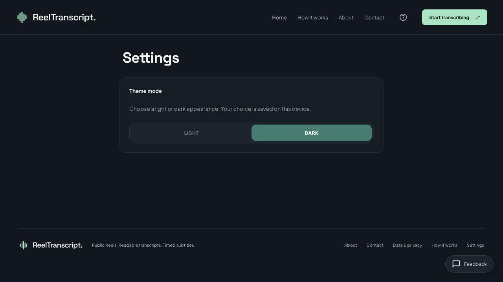

# ReelTranscript 产品文案与路由统一验收

生产域名：https://reelstranscript.com
部署：dpl_2dyWqB3dmaSNdHLNGsmAUheQoxNN（READY，Production）。

## 改动清单

| 文件 | 改前 → 改后 |
| --- | --- |
| views/AboutView.tsx | 旧音频练习产品介绍 → 公开 Reel 转录工具的用途、结果格式与范围 |
| views/HelpView.tsx | 上传音频、配置 key、分段练习 → 公开 Reel 链接提交、等待、Copy text、Download SRT 与错误帮助 |
| views/ContactView.tsx | 旧指南和音频/词汇本地保存说明 → 转录指南及刷新后不保留链接/结果的说明 |
| views/PrivacyView.tsx | 已撤下功能的数据说明 → 当前公开 Reel 的服务端处理、Cloudflare、页面结果、主题偏好和反馈说明 |
| lib/site-meta.ts | 旧产品 metadata → 当前产品描述；help 新标题；settings 独立 metadata 与 noindex；首页条目不变 |
| components/SiteHeader.tsx | 旧工具与账户入口 → Home / How it works / About / Contact；CTA 返回转录首页 |
| App.tsx | 旧工具 SPA 路由撤下；未知页引导回首页；页脚新 tagline 与 Settings 入口；离线提示更新 |
| views/LandingView.tsx | 首页下方残留旧产品文案与旧路径链接 → 公开 Reel 产品文案与有效路径；真实示例组件未改 |
| views/SettingsView.tsx | 模型、key、语言配置 → 仅 Light / Dark 主题，沿用现有偏好存储 |
| lib/render-public-pages.tsx | 同步新页脚；构建时增加 settings 独立 HTML，self canonical、noindex |
| vercel.json | 移除旧工具到首页的 rewrites；settings 指向自己的 HTML；index.html 以 308 收敛至 /；functions 与 headers 不变 |
| public/manifest.json | 启动地址 /library → /，避免安装后进入已撤下路径 |
| tests/{import-release,prerender,seo-static,site-info,website}.test.* | 更新已撤下产品的旧断言；覆盖产品导航、说明、settings metadata 与路由 |

未新增依赖。未修改任何 API、转录后端、模型配置、阈值、时间戳或 SRT 代码。未删除旧模块源码或用户已保存的数据；移除的是公共入口与页面路由。未改字体/配色/布局样式源文件。

## 未执行 JS 的生产抓取结果

下表数据来自实际 curl 抓取，所有 200 页面均与本地构建的对应 HTML 全文一致。完整字段见 production-checks.json，原始正文见同目录 HTML。

| 路径 | HTTP | Title | Canonical | H1 数量 | Robots |
| --- | --- | --- | --- | --- | --- |
| / | 200 | Instagram Transcript & SRT — ReelTranscript | https://reelstranscript.com/ | 1 | index, follow |
| /about | 200 | About ReelTranscript | https://reelstranscript.com/about | 1 | index, follow |
| /help | 200 | How ReelTranscript Works — ReelTranscript | https://reelstranscript.com/help | 1 | index, follow |
| /privacy | 200 | Data and privacy — ReelTranscript | https://reelstranscript.com/privacy | 1 | index, follow |
| /contact | 200 | Contact and feedback — ReelTranscript | https://reelstranscript.com/contact | 1 | index, follow |
| /tiktok-transcript | 200 | TikTok Transcript — Coming Soon | ReelTranscript | https://reelstranscript.com/tiktok-transcript | 1 | noindex, follow |
| /settings | 200 | Appearance settings — ReelTranscript | https://reelstranscript.com/settings | 1 | noindex, follow |
| /library | 404 | — | — | 0 | — |
| /vocabulary | 404 | — | — | 0 | — |
| /account | 404 | — | — | 0 | — |
| /add | 404 | — | — | 0 | — |
| /login | 404 | — | — | 0 | — |
| /auth/callback | 404 | — | — | 0 | — |
| /player/sample-1 | 404 | — | — | 0 | — |
| /nonexistent-x9 | 404 | — | — | 0 | — |

## 逐条验收

1. about/help：禁止的旧产品关键词均零匹配；两页正文不同，各一个 H1；help title 为 How ReelTranscript Works — ReelTranscript。页面段落按产品定位与操作说明分别撰写，没有复制首页正文。
2. library/vocabulary/account/add：实际 404；settings：200、自己的 canonical、noindex；login/auth callback/player 示例和随机未知路径同样 404。index.html 实际 308 至首页。
3. 首页：curl 前后 title、description、H1、canonical 逐字一致；静态真实示例 section 全文一致。index.html 与 components/ReelTranscriber.tsx 源文件哈希未变。
4. 六个原有公开页面：各 200，各自 canonical，各一个 H1，六个 title 两两不同。TikTok 保持 noindex。
5. sitemap：仍为 /、/about、/help、/privacy、/contact 五条正式域名 URL；TikTok 与 Settings 均未加入。robots 不变。
6. settings：静态 HTML 不含模型/key/语言配置，仅主题模式。浏览器实测 Light → 刷新仍为 light；切回 Dark 正常。生产截图已保存。
7. 禁止内容：本次生成的七个页面 HTML 中，旧品牌、旧部署域名、旧英语练习短句、Tailwind CDN 均零匹配。about/help/contact/settings 原始 HTML 中旧业务关键词零匹配。

## 检查与样式

- 类型检查：通过。
- 完整测试：111/111 通过；路由修改后补跑 prerender 测试通过。
- 生产构建：通过。
- 冻结文件哈希核对：API、三份后端文件、cue 引擎、requirements、首页模板、真实示例组件、两份样式源文件、sitemap 均不变。
- 部署包中的 api/server/scripts/lib 后端支持文件与上一部署逐字节一致。
- 使用 visual-verdict 核对同初始状态截图；首页六个代表元素的字体、字号、文字色、背景色、圆角与内边距均相同，详见 style-comparison.json。导航项和文字更换带来的宽度、换行属于本次内容变更，不声称全页像素完全相同。
- 没有重新调用 ASR；本轮验证的是文案、路由与主题控件，转录实现以字节/哈希比对确认未改。

